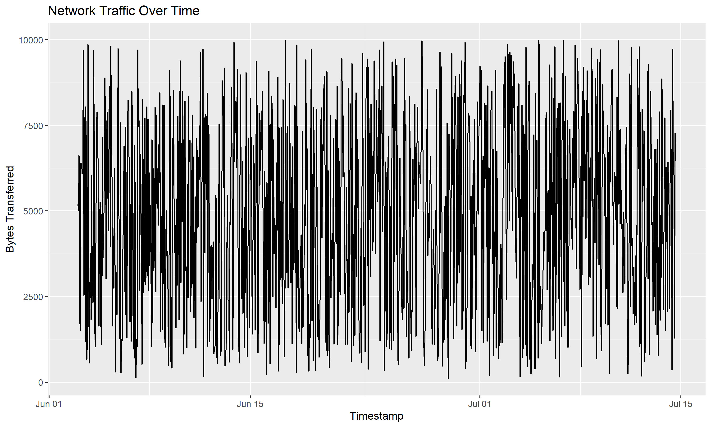
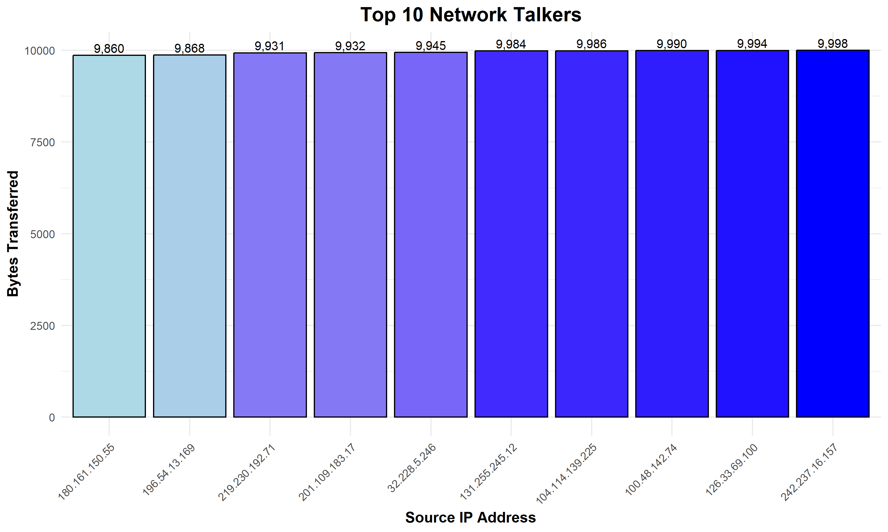
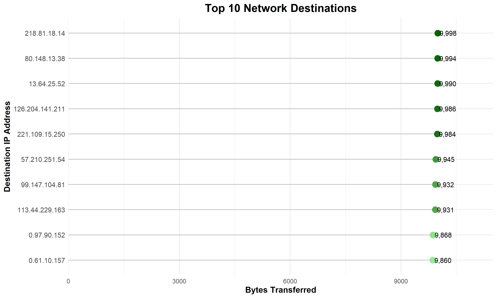
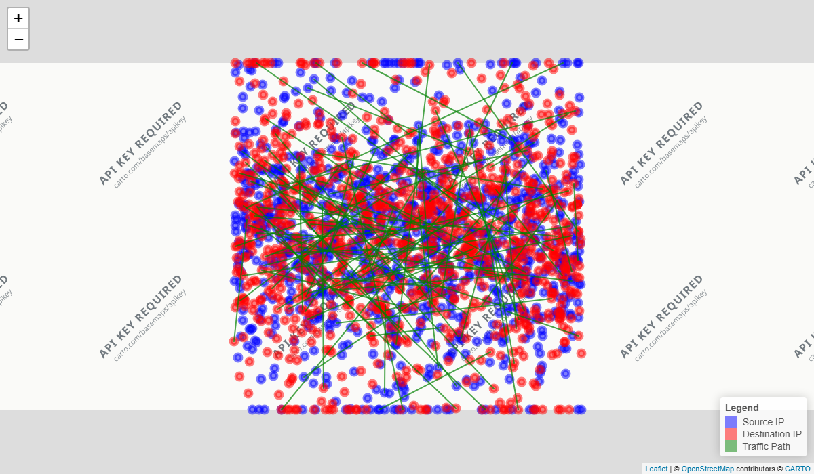

# Network Traffic Analysis & Visualization in R

A beginner-friendly R project that **simulates network traffic data** and visualizes it to show how traffic patterns, top senders, popular destinations and geographic flows can be analyzed.

The goal of a typical network traffic analysis project is to monitor, analyze and visualize data flow across a network. This helps identify patterns and trends, detect security threats and support decisions about network infrastructure.

> **Note:** All data in this project is synthetic (randomly generated). It demonstrates the techniques, not real-world traffic behavior. See [Limitations](#limitations).

---

## Table of Contents

1. [Features](#features)
2. [Project Structure](#project-structure)
3. [Requirements](#requirements)
4. [How to Run](#how-to-run)
5. [How It Works](#how-it-works)
6. [Dataset Description](#dataset-description)
7. [Visualizations](#visualizations)
8. [Limitations](#limitations)
9. [Documentation](#documentation)
10. [Credits](#credits)

---

## Features

- Reproducible synthetic dataset of 1,000 hourly network records
- Custom function to generate random IPv4 addresses
- Time series chart of bytes transferred
- "Top talkers" ranking of source IPs
- Destination analysis (lollipop chart)
- Interactive world map of source-to-destination paths (leaflet)

## Project Structure

```
network-traffic-analysis-r/
├── R/
│   ├── 01_generate_data.R      # Step 1: create the synthetic dataset
│   └── 02_visualizations.R     # Steps 2.1 - 2.4: all charts and the map
├── docs/
│   └── network_traffic_analysis_R_documentation.xlsx   # line-by-line code explanation
├── outputs/                    # saved plots and map (optional)
├── .gitignore
└── README.md
```

## Requirements

- R (4.0 or newer recommended)
- RStudio (optional but convenient)
- R packages:
  - `ggplot2`: static charts
  - `leaflet`: interactive map
  - `scales`: number formatting (used as `scales::comma`; installed with ggplot2)

Install the packages once:

```r
install.packages(c("ggplot2", "leaflet", "scales"))
```

## How to Run

1. Clone the repository:
   ```bash
   git clone https://github.com/YOUR-USERNAME/network-traffic-analysis-r.git
   cd network-traffic-analysis-r
   ```
2. Open R or RStudio in the project folder.
3. Run the scripts in order:
   ```r
   source("R/01_generate_data.R")     # creates the traffic_data data frame
   source("R/02_visualizations.R")    # builds all plots and the map
   ```

The visualization script expects `traffic_data` to exist, so always run step 1 first (or in the same session).

## How It Works

### Step 1: Creating the dataset

| Component | How it is generated | Purpose |
|---|---|---|
| Seed | `set.seed(123)` | Makes results reproducible |
| Timestamps | `seq.POSIXt()`, one per hour from 2024-06-03 00:00:00 | Simulates activity over time (about 41.7 days) |
| IP addresses | Custom `generate_ipv4()` using `sample(0:255)` four times, joined with `paste(..., sep = ".")` | Simulates devices communicating |
| Bytes transferred | `sample(100:10000, 1000, replace = TRUE)` | Simulates data volume per connection |
| Data frame | `data.frame(timestamp, source_ip, destination_ip, bytes_transferred)` | One row = one network-activity record |

### Step 2: Visualizations

| # | Analysis | Technique |
|---|---|---|
| 2.1 | Time Series | `ggplot2` + `geom_line()` of bytes over time |
| 2.2 | Top Talkers | `aggregate()` bytes by `source_ip`, sort, keep top 10, `geom_bar()` with gradient fill and value labels |
| 2.3 | Destination Analysis | `aggregate()` bytes by `destination_ip`, top 10, lollipop chart via `geom_segment()` + `geom_point()` |
| 2.4 | Geographical Map | Random latitude/longitude columns, `leaflet` circle markers (blue = source, red = destination) and green path lines |

For a complete line-by-line explanation of every statement, see the Excel file in [`docs/`](docs/).

## Dataset Description

| Column | Type | Description |
|---|---|---|
| `timestamp` | POSIXct | Hourly time of the record |
| `source_ip` | character | IPv4 address that sent the traffic |
| `destination_ip` | character | IPv4 address that received the traffic |
| `bytes_transferred` | integer | Data volume, 100 to 10,000 |
| `source_latitude` | numeric | Simulated latitude (-90 to 90), added in step 2.4 |
| `source_longitude` | numeric | Simulated longitude (-180 to 180), added in step 2.4 |
| `destination_latitude` | numeric | Simulated latitude, added in step 2.4 |
| `destination_longitude` | numeric | Simulated longitude, added in step 2.4 |

## Visualizations

Add screenshots of your outputs here after running the code, for example:

| Time series | Top 10 talkers |
|---|---|
|  |  |

| Top 10 destinations | Geographic map |
|---|---|
|  |  |

Tip: save plots with `ggsave("outputs/time_series.png", width = 10, height = 6)` and the map with `htmlwidgets::saveWidget(map, "outputs/traffic_map.html")`.

## Limitations

- **Synthetic data:** values are uniformly random, so the charts show no real patterns, peak hours or anomalies.
- **Top talkers:** with 1,000 random IPs out of roughly 4.3 billion possible addresses, nearly every IP appears only once. The "top talkers" are simply the largest individual records.
- **Random coordinates:** latitude and longitude are random numbers and are not derived from the IP addresses. A real project would use a GeoIP database.
- **Map paths:** verify that the polylines connect each source to its own destination rather than forming one continuous path across all rows.
- **Notebook option:** `options(repr.plot.width = 10, repr.plot.height = 6)` only affects Jupyter/IRkernel notebooks, not RStudio.

## Possible Improvements

- Replace random data with real packet captures or public network datasets
- Detect anomalies (for example unusually large transfers or traffic spikes)
- Use a GeoIP lookup for real locations
- Add protocol and port fields and analyze by service
- Build an interactive dashboard with Shiny

## Documentation

A detailed Excel workbook is included in `docs/`. It contains an overview, line-by-line code explanations, a data dictionary, a functions glossary and notes.

## Credits

The original code and concept come from the GeeksforGeeks article *Network Traffic Analysis Visualization in R*:
https://www.geeksforgeeks.org/r-machine-learning/network-traffic-analysis-visualization-in-r/

This repository reorganizes the code, adds documentation and notes limitations. Please credit the original source if you reuse it.

## License

Add a license of your choice (for example MIT) via a `LICENSE` file.